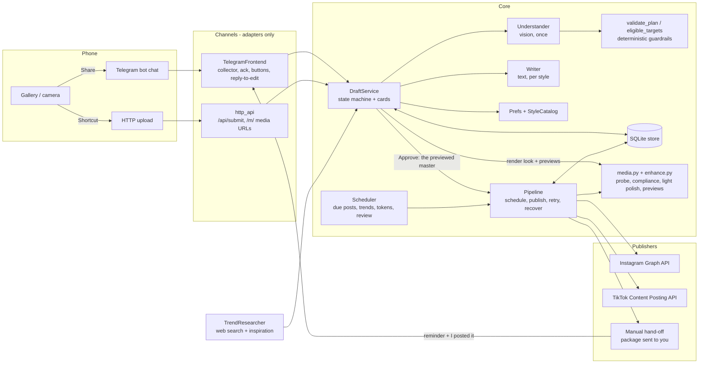
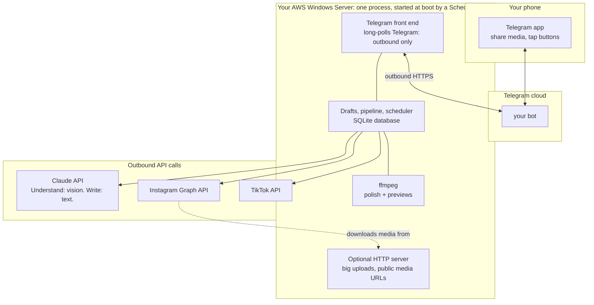
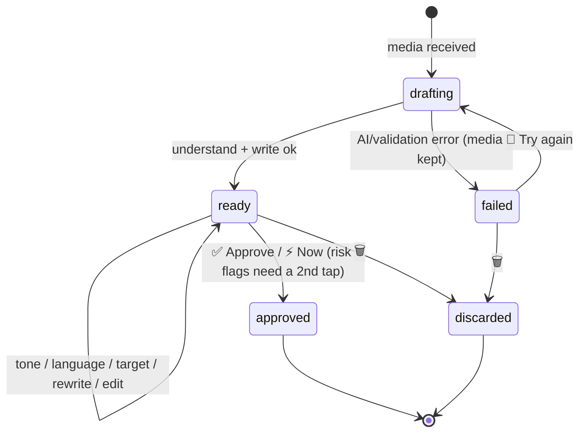
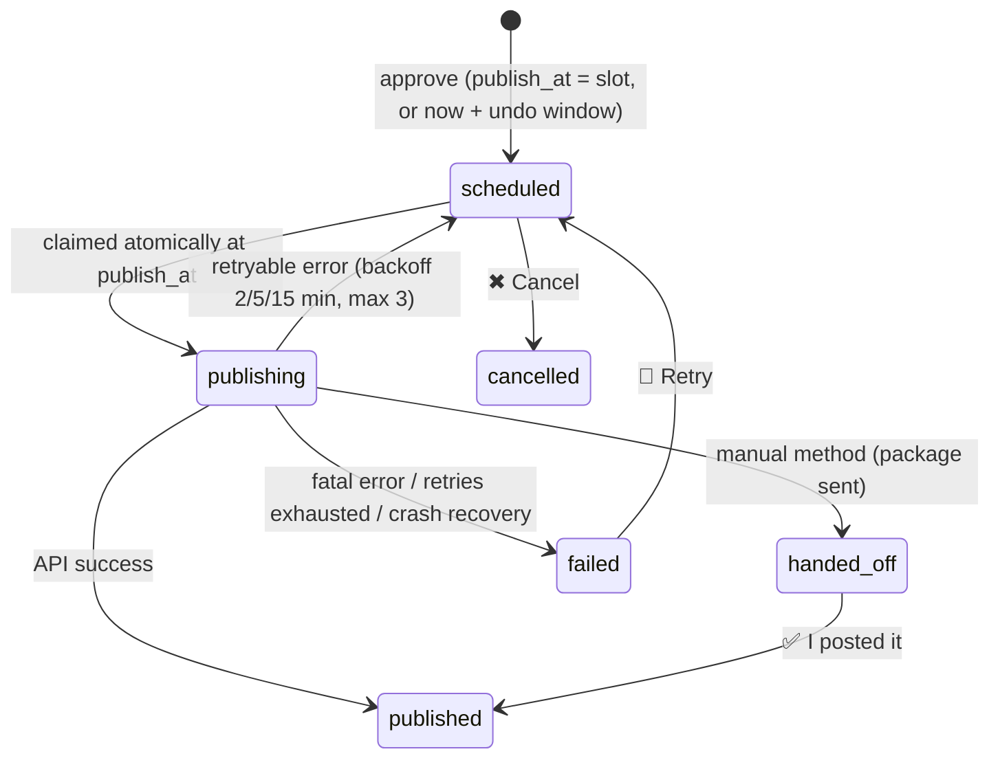

# Architecture: Social Agent (Phase 1 = draft-first)

Status: Phase 1 implemented and tested (414 automated tests; nothing run against the live Instagram / TikTok /
Telegram / Claude services yet, see §11). Phase 2 is partly built (light enhancement); the rest of Phases 2 and 3 is design only.

## 1. What changed and why

| Before | Now (Phase 1) |
|---|---|
| One Claude call looked at the media **and** wrote the final captions; the plan was scheduled straight away. | **Draft-first.** Every submission becomes a *draft card* you review. Nothing is scheduled or published until you tap **Approve**. |
| Style = one language list in `brand.yaml`. | **Tone × language × look per draft**, one tap each: **16 tones** (paged, e.g. 😂 Funny, 📝 Describe, ✨ Aesthetic, 📖 Story, 💡 Tips, 🔥 Hype, 💅 Sassy, 🥰 Wholesome…; add your own in `brand.yaml`) × EN / 简体 / 繁體 / EN+中 × photo look. Defaults in `/settings`; hints can be typed in the caption (“funny 中文”, “moody”). |
| Edits (reframe, trim, hook text) were on by default. | **Minimal, natural polish only** (`EDIT_LEVEL=enhance`, the default): exposure, contrast, shadows, highlights, colour vibrance and a touch of clarity, in four looks (Natural / Vivid / Bright / Moody) or Original. No face retouching, no reshaping, no creative cuts or text (those are Phase 2). Files are also fixed where a platform would reject them (HEIC/PNG → JPEG, HEVC → H.264, feed photos outside 4:5–1.91:1). `EDIT_LEVEL=none` posts your originals. |
| You approved text, not the media. | **You see the final media before posting.** The draft card arrives with the exact photo/video that will be published (downsized for chat). Switch look, tap **Compare** for a before | after image, and **Approve publishes that exact file**. |
| Posting required the Instagram/TikTok developer apps. | **Manual hand-off** works from the first message: the bot sends a ready-to-post package (the polished file + caption) at the scheduled time and you post in the native app. API publishing is optional. |
| Setup meant editing `.env` by hand. | **`socialagent setup`**: a guided wizard checks your Claude key and bot token live, finds your Telegram id by itself, and writes the config (§4.2). |

## 2. Channel decision: is a Telegram bot the best way to send media from a phone?

Requirements: media lives on the phone; sharing must be 1-2 taps; the reply must carry buttons (tone, language,
approve); photos *and* large videos; Chinese + English; no app to build; free.

| Option | Phone share-sheet | Buttons / cards | Big video | Setup effort | Verdict |
|---|---|---|---|---|---|
| **Telegram bot** | ✅ Share → Telegram → bot (iOS + Android) | ✅ inline keyboards; messages editable in place | ⚠️ 20 MB download via the cloud Bot API; lifted with a local Bot API server | low (BotFather, minutes) | **Chosen** |
| Native-share HTTP endpoint (iOS Shortcut / Android HTTP Shortcuts) | ✅ | ❌ one-way; results still need a channel | ✅ no size limit | low | **Kept as the big-video side door** (`POST /api/submit`) |
| WhatsApp Business Cloud API | ✅ | ⚠️ max **3** reply buttons per message (official docs); lists exist | ⚠️ ~16 MB video (secondary sources) | high: Meta business setup, dedicated number, message-window/template rules | Possible later through the same `Notifier` interface; heavier than it is worth for one owner |
| PWA with Web Share Target | ⚠️ **Android Chrome only**; iOS Safari cannot receive shares | ✅ full custom UI | ✅ | medium: auth, hosting, UI code | No: breaks on iPhone |
| Telegram **Mini App** (web UI inside the chat) | ✅ via the same bot | ✅✅ rich (grid preview, drag-reorder) | n/a | medium | **Phase 3 add-on**, same bot |
| Native iOS/Android app | ✅ | ✅✅ | ✅ | very high | Overkill |

Telegram wins on the combination (share-sheet reach, in-place editable cards, free, minutes to set up).
It is a *recommendation*, not a lock-in: the core talks to the owner only through two small interfaces
(`Notifier.present/notify` and `Card`), so another channel is an adapter, not a rewrite (§4).

Verified this session (via search of official/secondary docs): Telegram bots can download ≤ 20 MB and a local Bot API
server lifts it; WhatsApp reply buttons max 3; Web Share Target works on Android Chrome but not iOS Safari. Not verified:
WhatsApp's exact video limit (secondary sources only).

## 3. What "draft" can mean on each platform (verified)

| Platform | In-app draft via API? | What we do |
|---|---|---|
| Instagram | **No.** Official publishing is container → publish. A container that is not published within 24 h expires (`EXPIRED`), so staging early is not a draft. | The draft lives in *our* store. On Approve: **API** (container created at publish time) or **manual hand-off**. |
| TikTok | **Yes.** Upload-to-inbox puts a draft in the creator's TikTok inbox; you finish it in the app. | `TIKTOK_MODE=inbox` (“saved to your TikTok drafts”), or direct post (private-only until TikTok audits the app), or manual. |

Whether the inbox route is exempt from TikTok's audit restriction is **not confirmed**: the restriction is documented
for Direct Post; secondary sources suggest inbox uploads are not subject to it.

## 4. System overview



Layers and their single responsibility:

| Layer | Modules | Responsibility | Knows nothing about |
|---|---|---|---|
| Channels | `channels/telegram_bot.py`, `channels/http_api.py` | Receive media/text/taps, debounce albums, render `Card`s, enforce owner-only | AI, platforms |
| Conversation | `drafts.py`, `cards.py`, `prefs.py`, `styles.py` | Draft lifecycle, what each tap does, tone/language/look defaults, masters + previews, building the card | Telegram, ffmpeg internals |
| Agent brain | `brain.py` (`Understander`, `Writer`), `trends.py`, `llm.py` | Look at media once, write captions per style, research trends, analyse inspiration | Posting |
| Guardrails | `brain.validate_plan`, `eligible_targets`, `textutil`, `feed.choose_slot` | Enforce what each API can publish, hashtag/caption limits, slots | AI |
| Publish engine | `pipeline.py`, `scheduler.py`, `publishers/*` | Approved drafts → posts → platform; retries, undo window, crash recovery | How drafts were written |
| Media | `media.py`, `enhance.py`, `hosting.py` | Probe, platform-compliance conversion, light tonal/colour polish (looks), chat previews, public media URLs | Captions |
| State | `store.py` (SQLite) | Drafts, posts, trends, inspiration, highlights, prefs/tokens (kv) | Everything else |

### 4.1 Where each part runs ("where does the agent live?")

The Telegram bot is not a separate program that forwards tasks to a distant agent: **it is the front door of the same
program.** One Python process (`socialagent run`) on your AWS Windows Server contains the Telegram front end, the draft
logic, the scheduler, the media tools and the publishers. The only remote "brain" is the Claude API.



| Piece | Runs on | Notes |
|---|---|---|
| Telegram bot (the front door) | Your server, as part of the one process | Polls Telegram, so **no inbound port or domain is needed for Telegram**. |
| The "agent" logic (what to do with a submission) | Your server | Plain Python: state machine, guardrails, scheduler. It decides *when* to call Claude. |
| The "brain" (looking at the media, writing captions, researching trends) | Anthropic's servers (Claude API) | Your server sends a request and gets text back; no model runs on your machine. Needs `ANTHROPIC_API_KEY`. |
| Media polish and previews | Your server (ffmpeg) | Nothing is uploaded to a third-party editor. |
| Publishing | Your server → Instagram / TikTok APIs, or the manual hand-off | Instagram's API downloads media from your server, so that path needs a public HTTPS address (a Cloudflare Tunnel or reverse proxy in front of the agent's local port). |
| Claude Code (the tool used to build and maintain this) | Separate; not in the runtime path | It can drive the same CLI (`social-media-manager` sub-agent) to inspect or fix things; the agent keeps working when it is off. |

If the server is off, the bot does not answer (Telegram keeps your messages for ~24 h and delivers them when it is back
up), and scheduled posts wait; anything that came due while it was off is posted when it is back (however late), not lost, and anything interrupted mid-publish is
flagged for your review instead of re-sent.

### 4.2 Setup: what is automated and what only you can do

| Step | Who | How |
|---|---|---|
| Create the Telegram bot | **You** (30 s, in @BotFather on your own account; nobody else can) | `/newbot`, copy the token; optional `/setjoingroups` → Disable |
| Claude API key | **You** (console.anthropic.com) | Pasted into the wizard (hidden), checked live |
| Install Python, venv, package, `.env` permissions, Scheduled Task | `deploy\windows\install.ps1` | Untested on a real Windows Server (written without one) |
| Validate both keys, find your Telegram id, timezone, tone/language/look defaults, write `.env` + `brand.yaml` | `socialagent setup` (the installer launches it) | You message the bot once; it reads your id from that message and asks you to confirm. Secrets are never printed or logged; `.env` is owner-only |
| Public HTTPS address (only Instagram API posting, TikTok photo posts, big uploads) | **You**, in your DNS/Cloudflare account | A **Cloudflare Tunnel** (outbound only: no inbound ports, no clash with other apps on the server) or Caddy. The wizard picks a free local port (default 8787) and binds to localhost, so the agent is reachable only through the tunnel/proxy |
| Instagram / TikTok API access (developer apps, tokens) | **You**, later, optional | Not needed to start: manual hand-off works without it |

## 5. The seamless flow (what happens when you share a photo)

```mermaid
sequenceDiagram
  actor You
  participant TG as Telegram
  participant F as TelegramFrontend
  participant D as DraftService
  participant C as Claude
  You->>TG: Share photo (caption optional: "funny 中文")
  TG->>F: media message
  F-->>TG: "📥 Got it - one moment…" (instant; message A)
  Note over F: waits COLLECT_WINDOW (3 s) for the rest of an album / a follow-up text
  F->>D: create(paths, instruction, handle=A)
  par while Claude thinks
    D->>D: render the final media (ffmpeg polish, default look) + chat previews
  and
    D->>C: Understand (vision, ONCE): facts, mood, pillar, targets, risks
  end
  D->>C: Write (text only): captions in tone × language
  D-->>TG: the PREVIEW photo/video, then the DRAFT CARD (buttons) under it
  You->>TG: tap 😂 Funny / 简体 / ✨ Vivid / ☐ TikTok
  TG->>D: callback
  D->>C: Write again (text only, cheap)
  D-->>TG: same message A updated in place
  You->>TG: ✅ Approve  (or ⚡ Now, or reply "shorter")
  D->>D: take the previewed master, choose slot, create post(s)
  D-->>TG: card becomes "✅ Approved" with ✖ Cancel buttons
  Note over D: scheduler publishes at the slot: API, TikTok inbox, or sends you the manual package
```

Design points that make it feel seamless:
- **One message.** The acknowledgement becomes the draft card and every tap edits it. The chat never fills with cards.
- **See it before it posts.** The card sits directly under the final photo/video. Tapping a look re-renders only the media (cached per look, so switching back is instant); tapping **Compare** sends a before | after image. The file you approve is the file that is published.
- **Vision once, writing many times.** Changing tone or language re-runs only the text-only Writer (no pixels), so taps are
  fast and cheap. Claude's description of the media is stored as `facts`, and the Writer may only use those facts.
- **Zero taps in the common case.** Defaults come from `/settings`; hints typed in the caption override them
  (“funny 中文”, “story only”, “post at 8pm”).
- **Free-text edits without modes.** Reply to the card with a change (“shorter, mention Sunday”); start with `=` to use
  your own caption verbatim. Or use ✏️ / 💬 buttons, which ask for the text.
- **Per-draft locking.** Rapid taps are serialised so the card never shows a mixed state.

## 6. The agent's job description

**Roles**

| # | Job | How | Output |
|---|---|---|---|
| 1 | **Understand** the media | Vision call on photos / sampled video frames + owner instruction + feed state | Summary, mood, *facts*, pillar, risk flags, suggested targets, edit ideas (creative ones are Phase 2) |
| 1b | **Polish** the media | No AI: ffmpeg measures the picture (`signalstats`), then nudges exposure, shadows, highlights, contrast, vibrance, clarity toward the chosen look, each step capped | A master file per look + a chat preview; global light/colour only, never faces or content |
| 2 | **Write** captions | Text-only call: brand brief + facts + tone + language + trends + change request + previous draft (to avoid repeats) | Caption, hashtags, Story sticker idea per target |
| 3 | **Decide where / when** | Suggests from the *eligible* targets for this media; slot chooser applies windows, gaps, daily caps; you can toggle targets | Targets + suggested time on the card |
| 4 | **Keep the feed organised** | Content pillars balance, format variety, Story→Highlight tagging, weekly review, Highlights checklist | Pillar per post, checklist, review |
| 5 | **Research trends** | Daily web search (incl. Douyin/Xiaohongshu signals); falls back to evergreen formats and says so | Trend notes used only when they fit |
| 6 | **Learn your taste** | Inspiration board: TikTok links (oEmbed), TikTok data export, Douyin screenshots read by vision | Format/hook/recreate notes |
| 7 | **Keep things running** | Token refresh, retries with backoff, crash recovery, quota awareness, cleanup | Status messages only when something needs you |
| 8 | **Answer questions** | Free chat with queue/feed/trend context | Advice (no posting power) |

**Never** (enforced in code, not just in prompts): publish without your Approve; post a flagged draft without a second
confirming tap; invent facts beyond what is visible/stated; identify or name people from faces; follow instructions
found in trend/inspiration text or inside images; use unofficial Instagram/TikTok/Douyin access; retry after an
ambiguous publish failure; alter your media beyond global light/colour polish (no face retouching, reshaping, cropping or generated content); publish anything other than the file you previewed.

**Autonomy ladder**

| Level | Behaviour | Phase |
|---|---|---|
| 0 Manual hand-off | Bot prepares everything; you post in the app | 1 (default until API credentials exist) |
| 1 Draft → Approve → API publish | One tap publishes through the official API | **1** |
| 2 Auto-approve safe patterns | After N approved drafts of the same kind with no risk flags, skip the tap (undo window stays) | 3 |

## 7. Lifecycles



A draft is a mutable document. **Only `approve` creates publish jobs**, so the publish engine can never see an unapproved draft.



## 8. Data model (SQLite)

| Table | Purpose |
|---|---|
| `submissions` | The raw intake: media list (paths, codecs, sizes), instruction, source |
| `drafts` | Mutable draft: `state`, `tone`, `lang`, `brief_json` (Claude's understanding), `targets_json` (per target: selected, caption, hashtags, when, highlight…), `look`, `masters_json` (the final files the draft will publish), `card_ref` (the chat message that shows it) |
| `posts` | Immutable-ish publish jobs: platform, kind, final caption, prepared media, `publish_at`, `status`, `method` (`api`/`manual`), attempts, remote id |
| `trends`, `inspiration`, `highlights` | Research, references, Story→Highlight checklist |
| `kv` | Preferences (`prefs`), tokens (refreshed), job timestamps |

## 9. Publishing methods

| Platform | `api` | `manual` | Notes |
|---|---|---|---|
| Instagram | Graph API: photo, carousel, Reel, Story (container → poll → publish) | Reminder + caption/sticker text + “✅ I posted it” | No Highlights API → checklist; no in-app drafts |
| TikTok | Direct post (private until audited) or **inbox draft** | Reminder + caption | Photo posts need a verified media domain |

The default is `manual` until that platform's credentials exist, then `api`; `/settings` overrides per platform.
`DRY_RUN=true` swaps the API publishers for simulated ones; manual hand-off posts nothing, so it is unaffected.

## 10. Safety and failure model

Invariants (each has tests): DRY_RUN default · owner-only (filter + re-check in every handler) · approval before any
scheduling · risk-flag second tap · undo window · atomic claim (no double publish) · no auto-retry after an ambiguous
failure · crash recovery flags interrupted posts instead of re-sending · approve publishes exactly the previewed master · Claude only *proposes*, plain code validates ·
trend/inspiration/OCR text treated as untrusted · tokens never logged · secrets/data git-ignored.

| Failure | Behaviour |
|---|---|
| Claude error / refusal / bad JSON | Draft card becomes “❌ couldn't draft this” + 🔄 Try again; media kept; nothing posted |
| Rewrite fails | Previous captions kept; one-shot note on the card |
| File over 20 MB (cloud Bot API) | Actionable message (HTTP upload or local Bot API server) |
| Media can't be prepared | Draft stays open; reason shown on the card |
| Enhancement fails / HDR clip | That item falls back to your original (or is left as shot) and the card says so; the draft still works |
| Platform rate limit / transient error | Backoff retries (max 3) with notifications |
| Ambiguous publish outcome | Marked failed with “check the app”; never auto-retried |
| Server restart mid-publish | `recover()` marks it failed for your review |

## 11. Verification status (honest)

| Claim | Status |
|---|---|
| Logic, state machines, guardrails, publishers (vs. mock servers), Telegram handlers (vs. fake updates + real `Update` objects), CLI, HTTP | ✅ 414 automated tests |
| Instagram has no draft endpoint; containers expire in 24 h | ✅ official docs via search (no draft state found) |
| TikTok inbox upload = real in-app draft | ✅ documented; audit exemption ⚠️ unconfirmed |
| Telegram 20 MB limit; WhatsApp 3 buttons; Web Share Target Android-only | ✅ |
| Claude request shapes (structured output, effort, fallbacks, web search) | ✅ vs. SDK signatures · ❌ never called live |
| Telegram behaviour with the real service (edit-in-place, callback timing, albums) | ❌ not run live: expect small fixes on first use |
| Enhancement maths (identity at strength 0, monotone curves, capped moves, no luma shift, convergence when re-applied) | ✅ tested with real ffmpeg on synthetic images |
| Enhancement **looks good on your real photos/videos** | ❌ tuned numerically, not by eye: judge the preview, switch looks, or pick Original |
| Setup wizard (key checks, owner-id discovery, file writing, no secret printed) | ✅ against a mock Telegram server and scripted input · ❌ not run against real Telegram/Claude |
| Windows scripts (`install.ps1`), Docker | ⚠️ untested |

## 12. Roadmap

**Phase 1: Drafts + light polish (done).** Share → polished preview + draft card → tone/language/look/targets → approve →
API / inbox / manual. Acceptance: a photo shared to the bot returns the final image and a card; a tone tap changes the
caption without re-reading the media; a look tap re-renders without re-reading it either; nothing posts without Approve,
and what posts is what you previewed.

**Phase 2: Creative editing.** Light polish and previews already exist (above). Still to build: trims/cuts, hook-text
burn-in, reframing styles, cover-frame pick, carousel ordering, optional CapCut/Jianying draft export (desktop only), and
HDR tone-mapping. Plumbing exists (`EDIT_LEVEL=fit|creative`, ffmpeg reframe/overlay, draft export); missing is the
review loop (“apply this edit” taps) and trim suggestions in the Understand schema. Face/skin retouching is not planned:
it needs a dedicated model and judgement calls this project deliberately avoids.

**Phase 3: Autonomy and insight.** Auto-approve safe patterns, proactive nudges (“no food post in 6 days: send a photo”),
performance feedback from platform insights to tune what it suggests, a Telegram Mini App for grid preview, optional
second channel (WhatsApp), multiple accounts.

## 13. Adding another channel

Implement `Notifier` (`notify`, `present(card, handle) -> handle`, `send_files`) to show things, and call
`DraftService.create(paths, instruction, source, handle)`, `handle_action(draft_id, action)`, `instruct(draft_id, text)`
and `settings_action(action)` for input. Cards are plain data (`Card`, `Button`); nothing else changes.

## 14. Cost (rough, unmeasured)

The vision call dominates (images dominate its tokens). Each tone/language tap is a small text-only call. Set
`WRITER_MODEL=claude-sonnet-5-5` to make rewrites cheaper while keeping the default model for looking at media. Trend
research runs once a day. Check your own usage before relying on any figure.
