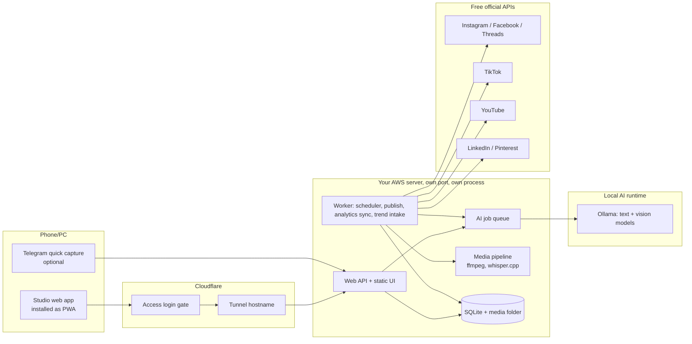
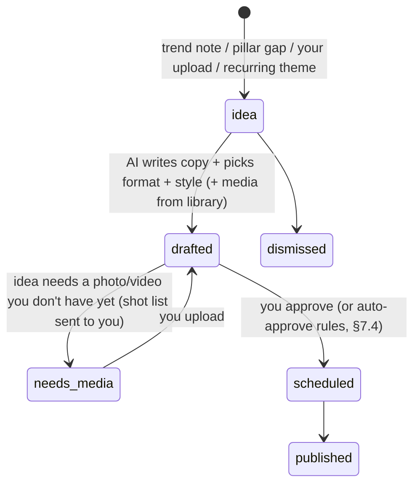

# Social Studio v2: architecture and design (proposed)

Status: **proposal, awaiting 4 decisions (§12)**. Nothing in this document is built yet. It replaces the Telegram-first
design in [ARCHITECTURE.md](ARCHITECTURE.md); the reusable parts of that code base are listed in §10.

Reference studied: [SamurAIGPT/postiz-cheap](https://github.com/SamurAIGPT/postiz-cheap) (Next.js 16, PostgreSQL/Prisma,
Google sign-in, MuAPI for AI + publishing, optional Stripe).

## 1. Goals

| # | Requirement (yours) | Design answer |
|---|---|---|
| G1 | Self-hosted web app, usable from a phone | One web app on your AWS server, installable on the phone home screen (PWA), responsive UI |
| G2 | Every postiz-cheap feature | Feature-parity map in §3 (with the few that cannot be zero-cost marked) |
| G3 | **Zero usage cost** (no per-call AI or API fees) | Local AI models (§6), only the platforms' own free official APIs (§5), free trend sources (§7). No MuAPI, no Claude API, no Stripe |
| G4 | Tag along on the existing AWS server (bbtracker, trvlplanner) | Own local port + its own Cloudflare Tunnel hostname; no shared ports, no shared database (§9) |
| G5 | Auto-manage content and ideas from current trends, e.g. Stories | Content engine: trend intake → idea board → auto-drafts into the scheduler, approval kept (§7) |
| G6 | Posts consistent and professional | Brand Kit: fixed looks, caption templates, fonts, logo/watermark, intro/outro, grid planner, a consistency checker (§8) |
| G7 | Auto-generate ideas and photo/video styles from uploaded media, then schedule | Upload → local vision model describes it → proposes formats + style preset + caption → draft in the calendar (§7.3) |

**Cost honesty.** "Zero usage cost" is achievable for AI, trends and the main platforms. It is **not** free to run:
the server, the domain and electricity/compute are yours. Local AI needs RAM the server may not have (§6.3), and that
is the one decision that can add infrastructure cost. X (Twitter) posting is **paid** (§5), so it is excluded by default.

## 2. What changes compared with postiz-cheap

| postiz-cheap | v2 | Why |
|---|---|---|
| MuAPI for AI, account connection, uploads and publishing (paid per use) | Direct official platform APIs + local AI | G3 |
| No background worker: scheduled posts fire only when someone opens the posts page | Always-on scheduler worker | Unattended posting needs it (their README says so) |
| Google sign-in + a demo login that does not check passwords | Single-owner login (password + TOTP) behind Cloudflare Access | Safer for a public hostname; no Google OAuth app to maintain |
| Stripe credit packs | Removed | Nothing is billed |
| PostgreSQL (separate service) | SQLite (one file), PostgreSQL optional | One owner, small data; nothing extra to run or patch on a shared server |
| AI writes text only | AI also looks at your media and proposes formats/styles; ffmpeg applies them | G6, G7 |

## 3. Feature parity map

✅ = included at zero cost · ⚠️ = included with a limit · ❌ = not possible at zero cost (optional, off by default)

| postiz-cheap feature | v2 | Notes |
|---|---|---|
| Calendar: day/week/month, statuses (scheduled, processing, published, failed) | ✅ | Plus "draft" and "needs approval" lanes |
| Drag-and-drop rescheduling, optimistic update | ✅ | |
| Colour tags / categories, filter by tag | ✅ | Tags double as content pillars |
| Posting time slots per channel, "next free slot" | ✅ | Already exists in the current code (`feed.choose_slot`) |
| Recurring posts | ✅ | Evergreen re-queue with a minimum gap |
| Composer: multi-channel, per-platform overrides, character counters | ✅ | |
| Live device preview per platform | ✅ | Feed / Story / Reel frames, plus the 9-tile grid preview for Instagram |
| AI writer (title, caption, tags per platform + tone) | ✅ | Local model; 16 tones and EN/中文 kept from v1 |
| AI agent workspace (chat, brainstorm) | ✅ | Local model; slower than a cloud model (§6) |
| First comment, Unicode rich text, signatures | ✅ | First comment where the API supports it |
| Threads/multi-post sequences | ⚠️ | Threads and LinkedIn only (X excluded) |
| Integrations page: connect / rename / disconnect accounts | ✅ | OAuth directly with each platform, your own developer apps (§5) |
| Media library: folders, tags, upload, cropper | ✅ | Plus the existing light-polish looks and before/after |
| Gallery of published videos | ✅ | |
| Analytics: summary cards, growth chart, top posts | ⚠️ | Only where the platform's free API exposes insights (Instagram, YouTube, Facebook, Threads; TikTok limited) |
| Client/brand profiles, team approval workflow | ✅ | Multiple brand kits; approval is the default flow |
| RSS feed → scheduler | ✅ | Also used as a trend source |
| Channels: Instagram, TikTok, YouTube, Facebook, LinkedIn, Threads, Pinterest | ✅/⚠️ | See §5 for each platform's free limits and reviews |
| Channel: X | ❌ | Pay-per-use API (§5); optional if you accept the cost |
| Stripe credits | removed | |

## 4. System overview

| Component | Responsibility |
|---|---|
| **Web API + UI** | Calendar, composer, media library, brand kits, idea board, analytics, integrations, settings. Serves the PWA |
| **Worker** | The only thing that publishes. Due posts, retries, token refresh, analytics sync, daily trend intake, auto-draft generation |
| **AI job queue** | All model calls are queued jobs (local models are slow); the UI shows progress and never blocks |
| **Media pipeline** | Light polish looks, crop/reframe, brand templates, Reels from photos, auto-subtitles, cover frames, previews |
| **Telegram** (optional) | Keep the v1 bot as a 2-tap "send to studio" from the phone gallery; drafts then appear in the web app |

## 5. Platforms: what is free, what needs review

All of these are **free official APIs**; the cost is your time for developer-app setup and reviews. Items marked ⚠️
come from documentation via search or from memory and must be confirmed during setup.

| Platform | Free? | Limits / gates you should expect |
|---|---|---|
| Instagram (Business/Creator) | ✅ | No Highlights or draft API; media fetched from your public URL; posting quota per 24 h (read from the API) |
| Facebook Pages | ✅ ⚠️ | App review for page-publishing permissions |
| Threads | ✅ ⚠️ | Own API and app permissions |
| TikTok | ✅ | Unaudited apps post **private only**; inbox-draft mode as the workaround |
| YouTube | ✅ ⚠️ | 10,000 quota units/day per project; an upload costs 1,600 units (≈6 uploads/day). Google's pages disagree on whether unverified projects are restricted to private uploads: verify |
| LinkedIn | ✅ ⚠️ | Personal profile posting is self-serve; company pages need Community Management API approval |
| Pinterest | ✅ ⚠️ | Trial access first, standard access after review |
| X | ❌ | 2026: pay-per-use credits, no general free tier (third-party figures around $0.015 per post). Off unless you opt in |

## 6. AI at zero usage cost

### 6.1 Jobs the AI does

| Job | Model type | Typical input → output |
|---|---|---|
| Describe uploaded media | Vision | photo / video keyframes → facts, mood, subjects, best format, suggested look, risk flags |
| Write captions, titles, hashtags | Text | facts + brand kit + tone + language + trend notes → per-platform copy |
| Ideas and content calendar | Text | trends + pillars + recent posts + analytics → idea cards with format and slot |
| Story sequences | Text (+ vision) | an idea or a set of media → 3–7 frame Story script with stickers/text |
| Subtitles | Speech-to-text (whisper.cpp) | video audio → timed captions burned in or as text |
| Agent chat | Text | your question + context → answer |

### 6.2 Provider design

One `AIProvider` interface with three back ends; you choose in Settings:

1. **Local (default):** Ollama on the same server, or on a PC you own that the server reaches through the tunnel
   (jobs queue while that PC is off). Zero per-call cost, private: media never leaves your machines.
2. **Free cloud tier (optional):** e.g. Gemini API free tier. Zero cost but rate-limited, the limits can change, and
   Google's (2024) terms let unpaid-tier data be used to improve its products. Off by default.
3. **Paid (optional, off):** the existing Claude integration, if you ever want top quality and accept the cost.

### 6.3 Hardware reality (the main risk)

Local models run on CPU unless the server has a GPU. Figures below are estimates from third-party sources, not measured:

| Setup | RAM free for AI | What it gives |
|---|---|---|
| Small: text ~3–4B + vision ~4B, quantised | ~6–8 GB | Usable. Captions in tens of seconds, a photo description in up to a few minutes on 4 vCPU |
| Medium: 7–8B text + 7B vision | ~12–16 GB | Better writing; slower on CPU |
| GPU instance | — | Fast, but AWS GPU instances cost real money: conflicts with G3 |

Two compatibility facts: Ollama's official Windows requirements list Windows 10 22H2+ (Home/Pro) and do **not** mention
Windows Server; Microsoft positions WSL2 on Windows Server 2022 for development/testing, not production. If your server
is Windows Server, the safest zero-cost path is running the AI on a PC you own, or a measured test of Ollama on the server
before committing.

Expectation: local small models write decent captions with a good brand kit and templates, but are noticeably weaker
than Claude at nuance, Chinese idiom and trend judgement. The design compensates with templates, examples from your
own best posts, and your approval on every draft.

## 7. Content engine (auto-manage ideas and posts)

### 7.1 Trend intake (free sources only)

| Source | How | Notes |
|---|---|---|
| Your own analytics | Platform insights APIs | The most reliable signal: what worked for *your* audience |
| Google Trends "Trending now" | Public RSS per country | Unofficial feed format: may change |
| YouTube most-popular chart | YouTube Data API (1 quota unit) | Per region/category |
| RSS feeds you choose | Niche blogs, news, competitors' public feeds | Also usable as "RSS → scheduler" |
| Inspiration board | Links/screenshots you save (TikTok/Douyin/Xiaohongshu) | No scraping of TikTok/Douyin: terms risk |

The local model clusters these into **trend notes** (what, why it fits the brand, format, expiry date). No paid web search.

### 7.2 Idea board → auto-drafts

- Daily job keeps a **rolling 2-week plan**: fills empty slots by pillar balance, format variety and trend expiry.
- **Stories**: daily Story sequences from recent uploads, trend notes and evergreen templates (polls, behind the scenes,
  tips), tagged to the right Highlight checklist.
- **Shot lists**: when an idea needs media you don't have, it tells you exactly what to film (phone notification).

### 7.3 From an upload to a scheduled post

Upload (web, PWA share, or Telegram) → vision describes it → engine proposes **2–3 options** (e.g. "carousel, Natural
look, educational caption" vs "Reel slideshow with subtitles, Vivid look, hook caption") → each option is rendered as a
real preview → you pick one → it drops into the next matching slot in the calendar.

### 7.4 Autonomy levels

| Level | Behaviour |
|---|---|
| 0 Suggest | Ideas only |
| 1 Draft (default) | Ideas become drafts with media and copy; you approve each |
| 2 Auto-approve rules | e.g. "Stories from my own uploads with no risk flags" publish without a tap, after an undo window |

Risk flags (people, minors, locations, brands, claims) always require approval, at every level.

## 8. Consistency: the Brand Kit

| Element | What it enforces |
|---|---|
| Looks | One house look per brand (from the v1 enhance engine) applied to every photo/video |
| Typography + colours | Fonts and palette for text overlays, covers and Story frames |
| Templates | Caption skeletons per format (hook → value → CTA), Story frame layouts, Reel intro/outro, cover style |
| Logo / watermark | Placement rules per format |
| Voice | Tone, banned words, emoji limit, hashtag sets, bilingual rules |
| Grid planner | 9-tile preview; warns about colour or format clumping |
| Consistency check | Before approval: look applied, caption matches template, hashtags within the set, text limits, aspect ratio, contrast |

Media styles are produced by ffmpeg templates, not generative image AI (that needs a GPU, which conflicts with G3):
polish looks, reframe to 9:16 / 4:5, Ken-Burns photo-to-Reel, subtitle styles, text overlays, intro/outro, cover frames.

## 9. Deployment alongside bbtracker and trvlplanner

- **Own process, own port** (default 8787, checked free at setup), bound to `127.0.0.1`.
- **Own Cloudflare Tunnel public hostname** (e.g. a new subdomain); existing hostnames untouched; no inbound ports.
- **Cloudflare Access** in front (single-owner email login) plus the app's own password + TOTP.
- **Own data folder** (SQLite + media); nothing shared with the other apps. Nightly backup of that folder.
- Resource caps: AI jobs run one at a time at low priority so bbtracker/trvlplanner keep their CPU.

## 10. Stack and reuse

| Layer | Choice | Why |
|---|---|---|
| Backend | Python 3.12 + FastAPI, existing `socialagent` package as the core | Reuses the tested scheduler, publishers (Instagram, TikTok), polish engine, safety rules; runs natively on Windows |
| Worker | Same codebase, separate process | Publishing never depends on a browser being open |
| Frontend | React + TypeScript (Vite) PWA, built to static files; FullCalendar for the calendar | Rich drag-and-drop composer/calendar; nothing Node-based runs on the server |
| Database | SQLite (WAL), migrations | One owner; PostgreSQL optional later |
| AI | Ollama (text + vision), whisper.cpp | Zero per-call cost |
| Media | ffmpeg | Already used |

Reused from v1 as-is or with small changes: `publishers/instagram.py`, `publishers/tiktok.py`, `pipeline.py` (atomic claim,
no-retry on ambiguous failure, crash recovery), `scheduler.py`, `feed.py`, `enhance.py`, `media.py`, `hosting.py`, `styles.py`,
the Telegram bot as an optional input. Replaced: `llm.py` (Claude) → `AIProvider`; the Telegram draft cards → web UI.

## 11. Delivery plan

| Milestone | Contents | Done when |
|---|---|---|
| M1 Foundation | FastAPI app, auth, SQLite schema, media library, PWA shell, worker process, Windows service + tunnel setup | You can log in from your phone and upload |
| M2 Calendar + composer | Calendar (drag/drop, tags, slots, recurring), composer with overrides and previews, Instagram + TikTok publishing (reused) | A post scheduled on the phone publishes unattended |
| M3 Local AI | AIProvider + Ollama, AI writer, media understanding, agent chat, job queue | Captions and options generated on your hardware |
| M4 Brand Kit + styles | Templates, looks, overlays, photo-to-Reel, subtitles, consistency check, grid planner | Every draft passes the check |
| M5 Content engine | Trend intake, idea board, rolling plan, Story sequences, shot lists, autonomy levels | A week fills itself with drafts for approval |
| M6 More channels + analytics | YouTube, Facebook, Threads, LinkedIn, Pinterest; insights, growth chart, top posts | Per §5 reviews |

## 12. Decisions needed before building

1. **Server size:** Windows Server version, vCPU, total RAM and how much the other two apps use. Decides whether AI runs
   on the server or on a PC you own (§6.3).
2. **AI back end:** local only / local + free cloud tier fallback / something else.
3. **Channels for M2–M6:** which of Instagram, TikTok, YouTube, Facebook, Threads, LinkedIn, Pinterest (X costs money).
4. **Telegram:** keep it as optional quick capture, or web app only.

## 13. Verification status of this design

| Claim | Basis |
|---|---|
| postiz-cheap features, stack, MuAPI dependency, missing worker, demo login | ✅ read from its repository (README, roadmap, schema, sources) |
| X API pay-per-use, no general free tier | ⚠️ official docs page and several 2026 third-party articles via search; prices from third parties |
| YouTube 10k units/day, upload 1,600 units | ⚠️ Google docs via search; private-upload rule conflicting |
| Ollama Windows requirements; WSL2 on Server 2022 for dev/test | ⚠️ official pages via search |
| Local model RAM/speed | ⚠️ third-party estimates; must be measured on your hardware |
| Gemini free tier and data-use terms | ⚠️ docs via search; terms found are from 2024 |
| Google Trends RSS | ⚠️ documented as a download option; URL format unofficial |
| Facebook/Threads/LinkedIn/Pinterest gates | ⚠️ from memory: confirm during setup |
